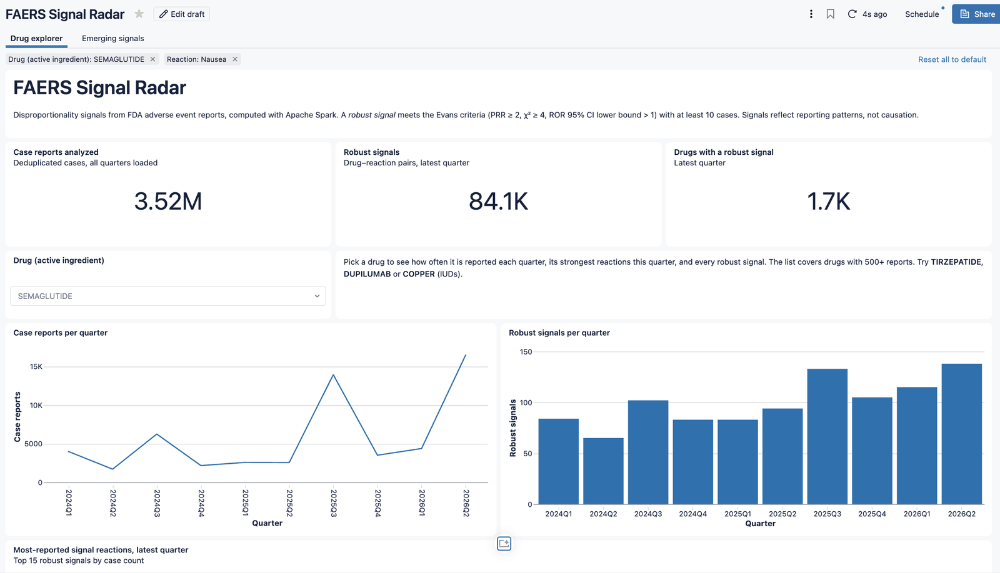

# FAERS Signal Radar

Drug safety signal detection over the FDA Adverse Event Reporting System (FAERS),
built with Apache Spark and Delta Lake. The same code runs on a laptop and on
Databricks (serverless), and is deployed with a Databricks Asset Bundle.



Full dashboard export: [docs/faers-signal-radar.pdf](docs/faers-signal-radar.pdf)

```
FDA quarterly zips ─► scripts/download.sh ─► data/raw  or  /Volumes/<catalog>/faers/raw
                                                │
            bronze_{demo,drug,reac,deleted}     │  every column as string + source_quarter
                                                ▼
            silver_cases                        latest version per case, deleted cases removed
            silver_case_drugs                   suspect drugs, normalized to active ingredient
            silver_case_reactions               MedDRA preferred terms
                                                ▼
            gold_signals                        PRR, ROR (95% CI), chi², is_signal
                                                per (quarter, drug, reaction)
```

## Data

FDA publishes one zip per quarter at
<https://fis.fda.gov/extensions/FPD-QDE-FAERS/FPD-QDE-FAERS.html>
(direct URL pattern `https://fis.fda.gov/content/Exports/faers_ascii_2026q2.zip`, ~60 MB each).

```bash
scripts/download.sh 2024Q1 2026Q2   # 2014Q3 or later; file layout differs before that
```

## Run locally

Requires Java 17+ and [uv](https://docs.astral.sh/uv/).

```bash
uv sync
uv run pytest -q
uv run faers-radar all              # writes Delta tables to data/lake/
```

## Run on Databricks (Free Edition works)

```bash
databricks bundle deploy                         # builds the wheel, creates schema, volume, job
databricks fs cp -r data/raw dbfs:/Volumes/workspace/faers/raw --overwrite
databricks bundle run faers_pipeline
```

The bundle also deploys and publishes the **FAERS Signal Radar** AI/BI dashboard
(`src/dashboards/faers_radar.lvdash.json`). It has a drug explorer (reports and robust
signals per quarter, top reactions, every signal) and an emerging-signals page (pairs
flagged for the first time in the latest quarter). After editing dataset SQL, check it
against your warehouse:

```bash
python3 scripts/check_dashboard_sql.py <warehouse_id>
```

Serverless compute can't reach arbitrary internet hosts, so raw files are landed
in a Unity Catalog Volume from outside. That's the same landing-zone pattern used
when ingesting from an external system.

## Method

For each (drug, reaction) pair, cases are counted in a 2×2 table:

|            | reaction | other |
|------------|----------|-------|
| **drug**   | a        | b     |
| **other**  | c        | d     |

- **PRR** = (a/(a+b)) / (c/(c+d))
- **ROR** = ad/bc, with 95% CI exp(ln ROR ± 1.96·√(1/a+1/b+1/c+1/d))
- **Signal** (Evans et al., 2001): a ≥ 3, PRR ≥ 2, Yates χ² ≥ 4, plus ROR lower bound > 1

Dedup follows FDA's guidance: per `caseid`, keep the latest `fda_dt`, breaking ties on the
highest `primaryid`, then drop cases in the quarterly deletion lists. Only primary and
secondary suspect drugs (`PS`, `SS`) count, not concomitant ones.

## Spark engineering notes

- **Pure transforms.** `transforms.py` holds only `DataFrame -> DataFrame` functions; I/O lives
  in `io.py`. Each step is unit-tested with `assertDataFrameEqual`.
- **No Python UDFs.** Drug normalization is native `regexp_replace`/`coalesce`, so it stays in
  the JVM and Catalyst can optimize around it.
- **ANSI-safe math.** Spark 4 enables ANSI mode by default, where `x / 0` raises. Zero cells
  in the 2×2 table are common, so all ratios use `try_divide`.
- **Skew.** The drug × reaction join explodes per case. A polypharmacy report with 40
  drugs and 30 reactions yields 1,200 rows. AQE's skew-join handling splits those partitions.
  <!-- TODO: add query-profile / Spark UI screenshot and before/after timing -->
- **Small broadcast side.** Per-quarter totals are broadcast explicitly; AQE picks the rest.
- **One codebase, two runtimes.** `get_spark()` returns Databricks' session when present,
  otherwise a local Delta-enabled one. Targets are a path locally or `catalog.schema` in Unity Catalog.

## Limitations

Disproportionality measures reporting patterns, not causation. FAERS is voluntary and
subject to stimulated reporting (media attention drives reports), duplicates, and missing
data. Drug names not mapped by FDA to an active ingredient are cleaned heuristically, so
brand and generic names can split one drug into several keys.
