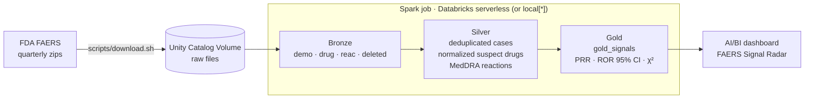

# FAERS Signal Radar

[](https://github.com/marcoss/databricks-faers-radar/actions/workflows/ci.yml)


**An Apache Spark pipeline that scans ~800K FDA adverse-event reports per run and surfaces
drug safety signals.** It runs on Databricks serverless, is deployed as code with Asset
Bundles, and ships with a published AI/BI dashboard.

**Status:** portfolio prototype, not production-ready. See [Prototype scope](#prototype-scope).

## What it finds

From the raw reports alone, the pipeline picks up safety stories that made the news:

- **Depo-Provera → meningioma.** Reports for medroxyprogesterone acetate with meningioma
  rose from **1,172 to 8,496 in one quarter** (2026Q1 → Q2, PRR ≈ 6,700). That spike followed a
  2024 BMJ study linking the two and the lawsuits that came after it, a textbook case of
  *stimulated reporting*.
- **Semaglutide (Ozempic/Wegovy) → eye and stomach effects.** About 200 reports per quarter of
  **optic ischaemic neuropathy** (PRR 58–349) and 800–1,100 per quarter of **impaired gastric
  emptying**, both publicly discussed GLP-1 concerns.
- **Copper IUD → device breakage.** More than 2,000 reports in a quarter each of **device breakage** and
  **complications of device removal**, matching widely reported Paragard complaints.

## 60-second tour

| If you want to see… | Look at |
|---|---|
| The result | [Drug explorer](docs/img/dashboard.png) · [Emerging signals](docs/img/emerging-signals.png) · [full PDF export](docs/faers-signal-radar.pdf) |
| The Spark code | [`src/faers_radar/transforms.py`](src/faers_radar/transforms.py): dedup, normalization, PRR/ROR/χ² |
| The Databricks deployment | [`databricks.yml`](databricks.yml): Unity Catalog schema, volume, serverless job, dashboard |
| The tests | [`tests/test_transforms.py`](tests/test_transforms.py): statistics checked against hand-computed 2×2 tables |


## Architecture



Every layer is a Delta table in Unity Catalog (`workspace.faers.*`), or a local Delta path when
running on a laptop.

## Where Apache Spark is used

All of the data processing is Apache Spark 4 (PySpark DataFrame API). There is no pandas and
there are no Python UDFs. Spark runs as `local[*]` on a laptop and as serverless compute on
Databricks, with no code changes between them.

| Stage | Spark work | Code |
|---|---|---|
| Bronze | Multi-file CSV reads (`$`-delimited, quoting off, file-name metadata via `_metadata`), Delta writes | [`io.py`](src/faers_radar/io.py) |
| Silver: dedup | `Window.partitionBy("caseid")` + `row_number()` to keep the latest case version, `left_anti` join to drop deleted cases | [`transforms.py`](src/faers_radar/transforms.py) |
| Silver: normalization | Native `regexp_replace` / `upper` / `when` column expressions to map free-text drug names to a canonical key | [`transforms.py`](src/faers_radar/transforms.py) |
| Gold: statistics | Per-case drug × reaction join (the big shuffle), `groupBy` counts, `left_semi` joins, broadcast join of per-quarter totals, PRR/ROR/χ² with `try_divide` | [`transforms.py`](src/faers_radar/transforms.py) |
| Tests | `pyspark.testing.assertDataFrameEqual` against hand-computed 2×2 tables | [`tests/`](tests/test_transforms.py) |
| Dashboard | Dataset queries run on a Databricks SQL warehouse (Spark SQL with window functions, CTEs, anti-joins) | [`faers_radar.lvdash.json`](src/dashboards/faers_radar.lvdash.json) |

Scale on two quarters (2026Q1–Q2): ~6.9M raw rows → 792K deduplicated cases → 469K scored
drug–reaction pairs. That takes ~47s locally on a MacBook and ~4 min end to end as a serverless job.

## Databricks products used

| Product | Role in this project | Defined in |
|---|---|---|
| **Databricks Asset Bundles** | Everything below is deployed with `databricks bundle deploy` | [`databricks.yml`](databricks.yml) |
| **Unity Catalog** | `workspace.faers` schema and bronze/silver/gold Delta tables, with lineage | [`databricks.yml`](databricks.yml), [`io.py`](src/faers_radar/io.py) |
| **Unity Catalog Volumes** | Landing zone for raw FDA files (serverless can't download them itself) | [`databricks.yml`](databricks.yml) |
| **Lakeflow Jobs on serverless compute** | 3-task bronze → silver → gold job running a Python wheel, quarterly schedule | [`databricks.yml`](databricks.yml) |
| **Delta Lake** | Storage format for every table, locally and in Unity Catalog | [`io.py`](src/faers_radar/io.py) |
| **AI/BI Dashboards** | Published *FAERS Signal Radar* dashboard (drug explorer and emerging signals) | [`faers_radar.lvdash.json`](src/dashboards/faers_radar.lvdash.json) |
| **Databricks SQL (serverless warehouse)** | Serves the dashboard queries | [`databricks.yml`](databricks.yml) |
| **Databricks CLI + GitHub Actions** | Lint and tests on every PR, bundle deploy on merge to `main` | [`ci.yml`](.github/workflows/ci.yml), [`deploy.yml`](.github/workflows/deploy.yml) |

Everything runs on **Databricks Free Edition**. The workspace needs a login, so the
dashboard is also exported as a [screenshot](docs/img/dashboard.png) and a
[PDF](docs/faers-signal-radar.pdf).

CI ([`ci.yml`](.github/workflows/ci.yml)) runs lint and tests on every PR. Deploys
([`deploy.yml`](.github/workflows/deploy.yml)) run on merge to `main` and need the
`DATABRICKS_HOST` and `DATABRICKS_TOKEN` repository secrets.

## Data

FDA publishes one zip per quarter at
<https://fis.fda.gov/extensions/FPD-QDE-FAERS/FPD-QDE-FAERS.html>
(direct URL pattern `https://fis.fda.gov/content/Exports/faers_ascii_2026q2.zip`, ~60 MB each).

```bash
scripts/download.sh 2024Q1 2026Q2   # 2014Q3 or later; file layout differs before that
```

## Run locally

Requires Java 17+ and [uv](https://docs.astral.sh/uv/).

```bash
uv sync
uv run pytest -q
uv run faers-radar all              # writes Delta tables to data/lake/
```

## Run on Databricks (Free Edition works)

```bash
databricks bundle deploy                         # builds the wheel, creates schema, volume, job
databricks fs cp -r data/raw dbfs:/Volumes/workspace/faers/raw --overwrite
databricks bundle run faers_pipeline
```

The bundle also deploys and publishes the **FAERS Signal Radar** AI/BI dashboard
(`src/dashboards/faers_radar.lvdash.json`). It has a drug explorer (reports and robust
signals per quarter, top reactions, every signal) and an emerging-signals page (pairs
flagged for the first time in the latest quarter). After editing dataset SQL, check it
against your warehouse:

```bash
python3 scripts/check_dashboard_sql.py <warehouse_id>
```

Serverless compute can't reach arbitrary internet hosts, so raw files are landed
in a Unity Catalog Volume from outside. That's the same landing-zone pattern used
when ingesting from an external system.

## Method

For each (drug, reaction) pair, cases are counted in a 2×2 table:

|            | reaction | other |
|------------|----------|-------|
| **drug**   | a        | b     |
| **other**  | c        | d     |

- **PRR** = (a/(a+b)) / (c/(c+d))
- **ROR** = ad/bc, with 95% CI exp(ln ROR ± 1.96·√(1/a+1/b+1/c+1/d))
- **Signal** (Evans et al., 2001): a ≥ 3, PRR ≥ 2, Yates χ² ≥ 4, plus ROR lower bound > 1

Dedup follows FDA's guidance: per `caseid`, keep the latest `fda_dt`, breaking ties on the
highest `primaryid`, then drop cases in the quarterly deletion lists. Only primary and
secondary suspect drugs (`PS`, `SS`) count, not concomitant ones.

## Spark engineering notes

- **Pure transforms.** `transforms.py` holds only `DataFrame -> DataFrame` functions; I/O lives
  in `io.py`. Each step is unit-tested with `assertDataFrameEqual`.
- **No Python UDFs.** Drug normalization is native `regexp_replace`/`coalesce`, so it stays in
  the JVM and Catalyst can optimize around it.
- **ANSI-safe math.** Spark 4 enables ANSI mode by default, where `x / 0` raises. Zero cells
  in the 2×2 table are common, so all ratios use `try_divide`.
- **Skew.** The drug × reaction join explodes per case. A polypharmacy report with 40
  drugs and 30 reactions yields 1,200 rows. AQE's skew-join handling splits those partitions.
  <!-- TODO: add query-profile / Spark UI screenshot and before/after timing -->
- **Small broadcast side.** Per-quarter totals are broadcast explicitly; AQE picks the rest.
- **One codebase, two runtimes.** `get_spark()` returns Databricks' session when present,
  otherwise a local Delta-enabled one. Targets are a path locally or `catalog.schema` in Unity Catalog.

## Prototype scope

What a production version would add:

- **Incremental ingestion.** Each run rebuilds every table. Production would use Auto Loader
  and `MERGE` so only new quarters are processed.
- **Drug name mapping.** Names FDA hasn't mapped to an active ingredient are cleaned with
  regexes, so a brand and its generic can split into separate keys. Mapping to RxNorm would fix this.
- **Data quality checks.** Row-count and null-rate expectations between layers (e.g. Lakeflow
  Declarative Pipelines expectations) before gold is published.
- **Signal context.** Scores reflect how often reactions are reported, not causation. They are
  also inflated by media-driven reporting spikes and don't separate a drug's indication from its
  side effects.
- **Separate dev and prod targets** with their own catalogs and a service principal for deploys.
